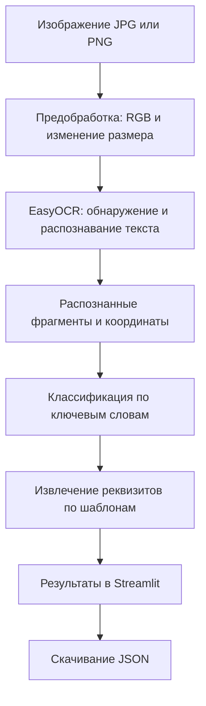
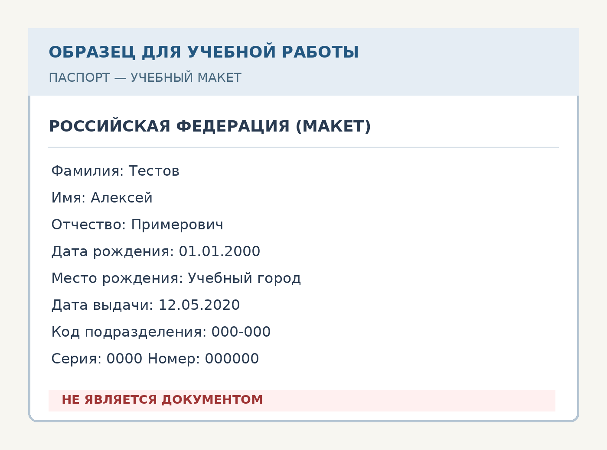
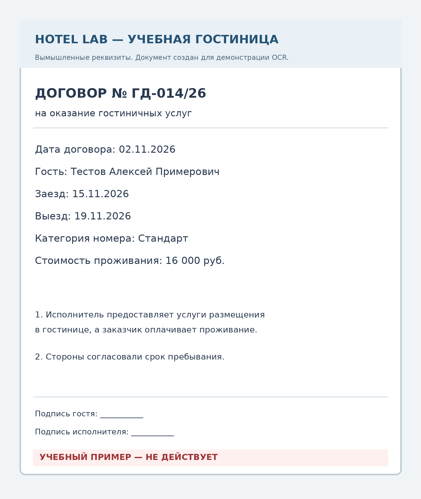

# HotelDoc AI — распознавание гостиничных документов с помощью нейросети

**Лабораторная работа по применению искусственного интеллекта в гостиничном деле**  
**Тип проекта:** учебное веб-приложение на Python  
**Назначение:** извлечение текста и реквизитов из изображений паспорта и договора на оказание гостиничных услуг.

---

## 1. Описание проекта

**HotelDoc AI** — прототип системы интеллектуальной обработки документов для гостиницы. Сотрудник службы приёма и размещения может загрузить фотографию или скан документа, получить распознанный текст и увидеть основные реквизиты, которые затем необходимо проверить перед внесением в систему учёта гостей.

Приложение использует **предобученную нейросетевую систему EasyOCR** для обнаружения и распознавания текста. Тип документа определяется по ключевым словам, а реквизиты извлекаются с помощью правил и регулярных выражений.

> **Важно:** нейросеть не обучается с нуля в рамках этой лабораторной работы. Используется готовая обученная OCR-модель. Классификация документов и извлечение реквизитов не являются отдельными нейросетевыми моделями.

### Функциональные возможности

- Загрузка изображений в форматах **PNG, JPG, JPEG** (до 10 МБ).
- Распознавание печатного текста на **русском и английском языках**.
- Определение типа документа: **«Паспорт»**, **«Гостиничный договор»** или **«Не определён»**.
- Извлечение реквизитов: ФИО, номера и даты документа, данных о проживании.
- Отображение найденных текстовых областей рамками на изображении.
- Просмотр полного текста и средней оценки уверенности OCR по распознанным блокам.
- Скачивание результатов в **JSON**.
- Работа с двумя готовыми учебными образцами с вымышленными данными.

## 2. Цель и задачи лабораторной работы

**Цель:** разработать и продемонстрировать веб-прототип применения нейросетевого распознавания документов для автоматизации операций в гостиничном деле.

**Задачи:**

1. Рассмотреть технологию оптического распознавания символов (OCR) с использованием нейросетей.
2. Реализовать загрузку и предварительную обработку изображения.
3. Подключить предобученную модель EasyOCR для получения текста и его координат.
4. Разработать правила определения типа документа и извлечения основных реквизитов.
5. Создать простой веб-интерфейс для работы с системой.
6. Продемонстрировать обработку учебного паспорта и гостиничного договора и проверить программную логику тестами.

**Практическая значимость:** подобные инструменты могут уменьшать объём ручного ввода при регистрации гостей и подготовке документов. При этом результаты OCR требуют проверки сотрудником: прототип не является полноценной системой регистрации.

## 3. Используемые технологии

| Технология | Назначение |
| --- | --- |
| **Python** | Основной язык программирования |
| **EasyOCR** | Нейросетевое обнаружение и распознавание текста |
| **PyTorch** | Среда выполнения нейросетевой модели |
| **Streamlit** | Веб-интерфейс приложения |
| **Pillow (PIL)** | Открытие и подготовка изображений, визуализация рамок |
| **NumPy** | Представление изображения в виде массива для EasyOCR |
| **`re` (регулярные выражения)** | Поиск номеров, дат и подписанных полей |
| **`unittest`** | Автоматизированные тесты программной логики |

Система запускает OCR **локально на процессоре (CPU)**. CUDA и видеокарта NVIDIA не требуются. При первом использовании EasyOCR загружает веса предобученной модели через интернет.

## 4. Принцип работы нейросети и алгоритм

**OCR (Optical Character Recognition)** — технология преобразования текста на изображении в машиночитаемые символы.

В проекте обработка состоит из пяти этапов:

1. **Загрузка изображения.** Пользователь выбирает готовый образец или прикрепляет свой JPG/PNG.
2. **Подготовка.** Изображение приводится к RGB, учитывается ориентация EXIF и при необходимости уменьшается до допустимого размера.
3. **Нейросетевое OCR.** EasyOCR находит текстовые области и распознаёт их содержимое. Для каждого блока возвращаются координаты, текст и оценка уверенности.
4. **Анализ текста.** Программа сопоставляет ключевые слова с категориями документов, после чего извлекает значения полей с помощью шаблонов.
5. **Отображение.** Веб-приложение показывает изображение с рамками, текст, реквизиты и позволяет скачать JSON.



### Какие поля извлекаются

| Документ | Поддерживаемые поля |
| --- | --- |
| Паспорт | Фамилия, имя, отчество, серия и номер, дата рождения, дата выдачи |
| Гостиничный договор | Номер и дата договора, ФИО гостя, даты заезда и выезда, номер/категория номера |

Извлечение лучше всего работает на учебных макетах с явными подписями вида **«Фамилия: ...»** или **«Заезд: ...»**. В документах с другой вёрсткой часть полей может не определиться.

## 5. Структура проекта

```text
HotelDoc_AI/
├── app.py                    # Веб-интерфейс Streamlit и запуск OCR
├── core.py                   # Классификация и извлечение полей
├── generate_examples.py      # Генерация учебных изображений
├── requirements.txt          # Зависимости Python
├── run_windows.bat           # Автоматизированный запуск на Windows
├── README.md                 # Отчёт и документация
├── examples/
│   ├── passport_demo.png     # Учебный макет паспорта
│   └── contract_demo.png     # Учебный гостиничный договор
└── tests/
    └── test_core.py          # Автоматические тесты
```

## 6. Установка и запуск

### Вариант А. Windows — автоматический запуск

1. Установите **Python** с [официального сайта](https://www.python.org/downloads/). Скрипт `run_windows.bat` ищет Python **3.11–3.14**. Для Python 3.14 совместимость всей цепочки библиотек на конкретной системе необходимо проверить установкой.
2. Скачайте репозиторий с GitHub через **Code → Download ZIP** и распакуйте его (либо выполните `git clone` для своего репозитория).
3. Откройте папку проекта, где находятся `app.py` и `run_windows.bat`.
4. Дважды щёлкните по **`run_windows.bat`**.
5. При первом запуске скрипт создаст окружение `.venv`, установит PyTorch (CPU) и остальные зависимости, а затем запустит веб-сервер.
6. Откройте в браузере **http://localhost:8501**.

**Первый запуск требует подключения к интернету** для скачивания библиотек и весов EasyOCR. Установка PyTorch может потребовать значительного места на диске.

### Вариант Б. Windows — вручную через PowerShell

Запустите PowerShell в папке проекта:

```powershell
py -3.14 -m venv .venv
.\.venv\Scripts\python.exe -m pip install --upgrade pip
.\.venv\Scripts\python.exe -m pip install torch torchvision --index-url https://download.pytorch.org/whl/cpu
.\.venv\Scripts\python.exe -m pip install -r requirements.txt
.\.venv\Scripts\python.exe -m streamlit run app.py --server.address 127.0.0.1
```

Если установлен Python 3.12, замените `py -3.14` на `py -3.12`. Использование полного пути к `.venv\Scripts\python.exe` позволяет не менять политику выполнения скриптов PowerShell.

### Вариант В. Linux / macOS

```bash
python3 -m venv .venv
source .venv/bin/activate
python -m pip install --upgrade pip
python -m pip install -r requirements.txt
python -m streamlit run app.py --server.address 127.0.0.1
```

Наличие совместимых бинарных пакетов PyTorch/EasyOCR зависит от ОС и версии Python.

### Возможные ошибки

| Проблема | Что проверить |
| --- | --- |
| `Python ... was not detected` | Выполните `py -0p` или `python --version`; проверьте установку и PATH |
| Ошибка `pip install` | Посмотрите название библиотеки и сообщение об ошибке; при проблемах совместимости попробуйте Python 3.12 в отдельном окружении |
| Виртуальное окружение использует другую версию Python | Переименуйте `.venv` в `.venv_old` и повторите запуск |
| Приложение не открывается | Проверьте сообщения в консоли и адрес `http://localhost:8501` |
| EasyOCR не загружает модель | Проверьте доступ к интернету при первом распознавании |

## 7. Порядок выполнения лабораторной работы

1. Запустите приложение через `run_windows.bat` или команду Streamlit.
2. На странице выберите **«Учебный паспорт»**.
3. Нажмите **«Распознать документ»**.
4. Изучите распознанный текст, выделенные области и извлечённые реквизиты.
5. Нажмите **«Скачать результат (JSON)»**, чтобы получить структурированные данные.
6. Повторите действия с вариантом **«Учебный договор»**.
7. При необходимости выберите **«Загрузить своё»** и укажите JPG/PNG без реальных персональных данных.
8. Сравните результаты и отметьте возможные ошибки распознавания.

### Учебные изображения

**Макет паспорта** — специально созданный образец, содержащий вымышленные сведения:



**Макет договора на оказание гостиничных услуг**:



Все персональные сведения в этих примерах вымышлены; изображения не являются действительными документами.

## 8. Результаты и проверка

Результат обработки доступен в интерфейсе и в JSON. Например, поле `document_type` содержит определённую категорию, `fields` — извлечённые реквизиты, `text` — весь распознанный текст, `ocr_blocks` — координаты отдельных текстовых фрагментов и оценки уверенности.

Упрощённый **пример структуры результата** (иллюстрация формата, а не протокол фактического прогона модели):

```json
{
  "document_type": "Гостиничный договор",
  "fields": {
    "Номер договора": "ГД-014/26",
    "Дата договора": "02.11.2026",
    "Гость": "Тестов Алексей Примерович",
    "Дата заезда": "15.11.2026",
    "Дата выезда": "19.11.2026",
    "Номер / категория": "Стандарт"
  }
}
```

Для проверки программной логики предусмотрены автоматические тесты. Запустите из корня проекта:

```bash
python -m unittest discover -s tests -v
```

**Результат локальной проверки программной логики: 5 тестов пройдены.** Тесты проверяют определение типов документов, извлечение реквизитов, обработку неизвестного текста и преобразование результата OCR. Они **не проверяют точность самой нейросети на изображениях**. Полноценное количественное измерение точности распознавания потребовало бы набора размеченных документов и оценки ошибок.

## 9. Ограничения и вопросы безопасности

- Поддерживаются **изображения JPG/PNG**; распознавание PDF не реализовано.
- Система распознаёт текст, но **не подтверждает подлинность паспорта**, действительность документа или юридическую силу договора.
- Тип документа определяется правилами, а не обученным нейросетевым классификатором.
- Оценка уверенности EasyOCR относится к результатам распознавания текстовых блоков; она **не является вероятностью подлинности документа**.
- Качество OCR зависит от разрешения, освещения, бликов, наклона, языка, шрифта и структуры документа.
- Приложение обрабатывает изображение локально и **не использует облачный OCR API**. В коде нет функции сохранения загруженных изображений или результатов анализа в серверные файлы. Пользователь может самостоятельно скачать JSON.
- Для лабораторной работы следует использовать только учебные и обезличенные изображения. **Не публикуйте в GitHub реальные паспорта, договоры или выгрузки JSON с персональными данными.**
- Для реальной эксплуатации потребуются дополнительные меры: правовые основания обработки персональных данных, разграничение доступа, защита данных, контроль сроков хранения, аудит действий и ручная проверка распознанных сведений.

## 10. Вывод

В ходе лабораторной работы создан учебный прототип веб-приложения **HotelDoc AI** для применения искусственного интеллекта в гостиничном деле. Предобученная нейросетевая система EasyOCR используется для получения текста с изображений; правила обработки позволяют определять тип документа и извлекать часть реквизитов.

Проект демонстрирует принцип автоматизации работы с документами на стойке регистрации, однако **не заменяет проверку документов сотрудником** и не является готовой системой промышленной эксплуатации.

**Возможные направления развития:** поддержка PDF, чтение машиносчитываемой зоны паспорта (MRZ), более устойчивое извлечение полей, обучение классификатора на размеченном наборе документов и интеграция с гостиничной системой управления (PMS).
